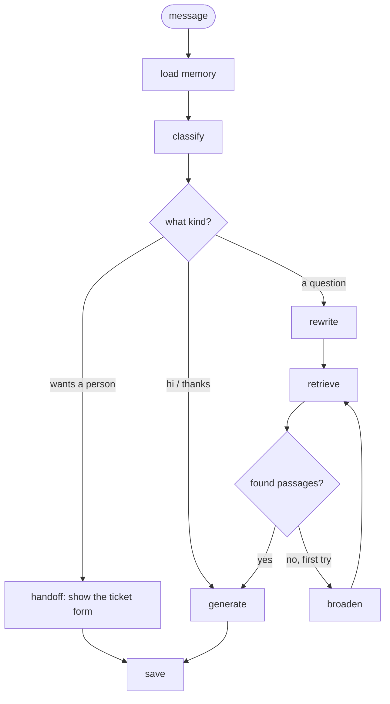

# How ShopEase Help works (explained simply)

This guide walks through the whole system in plain words: how the assistant learns the store's rules,
how it answers, how it remembers a chat, and how a customer reaches a real person.
Each part names the file that does the job, so you can open the code alongside.

---

## 1. The one-line idea

> **RAG = before answering, look it up in the book.**

Claude is a very good writer, but it has never read ShopEase's rules. So for every question we first
**find the right pages** in the store's handbook, then give those pages to Claude and say *"answer from this"*.

- **R**etrieval: find the right pages
- **A**ugmentation: put those pages into the question
- **G**eneration: Claude writes the answer from them

Think of a new shop helper with a rule book. Training would mean making them memorise every rule,
and doing it again whenever a rule changes. RAG means handing them the book and saying "check before you answer".
Change the book and they know the new rule straight away.

| | Training | RAG (this project) |
|---|---|---|
| Where the knowledge lives | Inside the model | In a PDF next to the model |
| A rule changes | Train again | Replace the PDF, run the ingest |
| Shows where an answer came from | No | Yes, every answer lists its sources |
| Makes things up | Can | Much less: "answer only from these pages" |

---

## 2. Two moments: preparing the book, then answering

| | When | Command |
|---|---|---|
| **Ingest**: read the PDF into the knowledge base | Once, and again when the PDF changes | `python -m scripts.ingest` |
| **Answer**: every message a customer sends | All the time | `python -m app.main` |

---

## 3. Preparing the book (ingest)

The handbook is `backend/data/shopease_support_handbook.pdf`: 11 pages, 9 chapters
(account, orders, delivery, payments, returns, warranty, offers, and support tickets).

```
PDF ──► read ──► clean ──► cut into passages ──► turn into numbers ──► save in Postgres
```

1. **Read** (`app/rag/ingestion/loaders.py`). pdfplumber takes the text from each page. Tables become
   small text tables so prices stay on their rows. A scanned page with no text is read with OCR.
2. **Clean** (`cleaning.py`). The line repeated at the top or bottom of every page
   ("ShopEase Customer Support Handbook · Page 3") is removed, and broken lines are joined into sentences.
3. **Cut into passages** (`chunking.py`). Every heading starts a new passage, so one passage = one policy
   ("Return Policy", "Delivery Charges", "Waiting in the Support Queue"). The result is **63 passages**.
4. **Turn into numbers**. A small multilingual model turns each passage into **384 numbers** that capture
   its meaning. Passages about money back end up close together; passages about passwords end up far away.
   It runs on your own computer, so it costs nothing.
5. **Save** (`app/stores/pgvector.py`). Each passage goes into a Postgres table with its 384 numbers
   (for meaning search) and a keyword index (for exact-word search).

---

## 4. Answering a question

Every message goes through a small workflow built with **LangGraph** (`app/graph/`).
Each box is one step; the diamonds are decisions.



| Step | What happens | Uses Claude? |
|---|---|---|
| **load memory** | Gets the last 4 turns of this chat and a short summary of anything older | no |
| **classify** | Simple patterns: a greeting skips the search; "talk to a person" goes to handoff | no |
| **rewrite** | A follow-up ("how long does *it* take?") or Urdu becomes a clear English search query | small call, only when needed |
| **retrieve** | Finds the 4 best passages (next section) | no |
| **broaden** | Nothing matched: rephrase and search again, a little wider (once) | small call |
| **generate** | Claude answers from the passages, can use tools, and the answer streams in word by word | yes |
| **handoff** | Replies "please fill in the form below" and the chat panel shows the ticket form | no |
| **save** | Stores the question and answer with sources and token usage | summary in the background |

### Finding the right passages (retrieve)

Two searches run together, because each catches what the other misses:

- **Meaning search** (pgvector) knows "money back" is close to "refund".
- **Keyword search** (Postgres full-text) reliably catches exact words like "COD" or "PTA".

```
query ─┬─► meaning search (20) ─┐
       └─► keyword search (20) ─┴─► merge (rank fusion) ─► drop weak ones (< 0.3) ─► rerank ─► top 4
```

The **reranker** is a second small model that reads the question and each passage together. It is slower but
more accurate, so it only looks at the few that are left. Code: `app/rag/retrieval.py`.

### Writing the answer (generate)

Claude gets the 4 passages, the recent chat and the question, plus rules from `app/prompts/system.md`:
answer only from the passages, keep it short, reply in the customer's language, never invent policies.

Claude also has two **tools** (`app/tools/`):

| Tool | When Claude uses it | What happens |
|---|---|---|
| `lookup_order` | The customer gives an order number like SE10482931 | Reads the live status from the `orders` table |
| `open_support_ticket` | The customer wants a person, or the handbook says the problem needs staff (late refund, damaged item, complaint) | The chat panel shows the ticket form under the answer |

### Watching it live

The answer is not sent all at once. Flask keeps the connection open and sends small events as each step
finishes (Server-Sent Events): `step` (which step is running), `meta` (the passages found), `tool`,
`delta` (the next few words) and `done`. That drives the live trace and the typing effect in the chat.

---

## 5. Memory: how it remembers the chat

Claude remembers nothing between calls. So every time, we send the memory along, kept small to save tokens:

- the **last 4 turns** word for word (long old answers are cut to 600 characters)
- a **running summary** of everything older, updated in the background after each answer

There are no accounts. The browser makes a random **visitor id** and sends it with every request, and the
API only shows that visitor their own chats and tickets. Everything is stored in Postgres:

| Table | Holds |
|---|---|
| `chunks` | the 63 handbook passages with their numbers |
| `conversations` | one row per chat: title, visitor id, running summary |
| `messages` | every message: customer, assistant, agent or system line, with sources, usage, feedback and time |
| `handoffs` | support tickets: status, customer name, email, issue, agent, times |
| `ticket_files` | files attached to tickets |
| `orders` | demo orders SE10482931 to SE10482936 |

Tables are created and upgraded by numbered files in `app/db/migrations/` when the API starts.

---

## 6. Talking to a person (support tickets)

When a customer asks for a person (or Claude decides they need one):

```
"talk to a person" ─► ticket form ─► queue (No. 2, about 6 min) ─► agent joins ─► chat ─► agent closes ─► bot again
```

1. **The form.** The chat shows a short form: name, email, issue (pre-filled with their last question) and up
   to 3 files (images, PDF or text, 5 MB each). Name and email are remembered for next time.
2. **The queue.** Sending it creates a ticket (e.g. SE-48012) and the customer sees their place in line:
   *"All agents are busy. You're number 2 in line · about 6 mins"*. Each agent handles one chat at a time,
   so the estimate is: people ahead ÷ agents on shift × the average chat length (starts at 5 minutes,
   then uses real closed tickets). Code: `app/support/desk.py`.
3. **The agent.** In `/admin` the agent signs in with their name and the admin token, sees the queue, opens the
   ticket (name, email, issue and files on top, the earlier bot chat below) and clicks **Take ticket**.
   The customer sees "Ali joined the chat".
4. **Chatting.** While a person handles the chat, the customer's messages go to the agent, not the bot.
   Both sides see "… is typing" and every message has its time.
5. **Closing.** The agent clicks **Close ticket** (or the customer clicks **Leave queue** / **End chat**) and the
   bot starts answering again.

### Why it feels instant: WebSockets

The chat panel and `/admin` each keep a WebSocket open (`/ws/support`, `/ws/admin`, in `app/api/live.py`).
When anything changes (a ticket opens, an agent joins, a message or a typing signal), the server pushes it
straight away through a small in-memory message bus (`app/realtime/hub.py`). If the connection drops, the page
reconnects by itself and checks every 3 seconds in the meantime, so nothing is missed.

---

## 7. Which part does what

| Where | Job |
|---|---|
| `backend/data/*.pdf` | The handbook: the store's knowledge |
| `backend/app/rag/ingestion/` | Read, clean and cut the PDF into passages |
| `backend/app/rag/retrieval.py` | Find the best passages (hybrid search + rerank) |
| `backend/app/rag/generation.py` | Ask Claude: rewrite queries, stream answers, run tools, summarise |
| `backend/app/graph/` | The LangGraph workflow: steps and decisions |
| `backend/app/support/desk.py` | Tickets and the queue: open, take, reply, close, wait estimate |
| `backend/app/api/` | HTTP routes, SSE streaming, WebSockets, admin endpoints |
| `backend/app/providers/` | Swappable models: Claude, Ollama, OpenAI-compatible, local embeddings |
| `backend/app/prompts/*.md` | What the assistant is told, in plain text files |
| `frontend/app/page.js` | The store page with the "How it works" section |
| `frontend/app/components/SupportWidget.js` | The chat panel: answers, sources, ticket form, queue, agent chat |
| `frontend/app/admin/` | The agent console |
| `deploy.sh` | Puts everything on the server in one command |

---

## 8. Knobs you can turn (`backend/app/core/config.py` or `.env`)

| Setting | Now | Turn it up | Turn it down |
|---|---|---|---|
| `TOP_K` | 4 | More passages, more tokens | Might miss information |
| `MIN_SCORE` | 0.3 | Only very close passages | More passages, more noise |
| `MEMORY_TURNS` | 4 | Remembers longer, costs more | Cheaper, forgets sooner |
| `LLM_MODEL` | Haiku | Sonnet or Opus: smarter, pricier | Haiku: fast and cheap |
| `SUPPORT_AGENTS` | 2 | Shorter queue estimates | Longer estimates |
| `DAILY_REQUEST_CAP` | 400 | More bot answers a day | Protects the API bill |

---

## 9. Try these to see it working

1. **Different words, same meaning:** "my thing broke, can I swap it?" still finds the returns policy.
2. **Urdu:** "refund kitne din mein milta hai?" gets rewritten to English for the search, answered in Urdu.
3. **An order:** "where is my order SE10482931?" makes Claude call `lookup_order`.
4. **Not in the book:** "who is the CEO?" widens the search once, then offers to connect you to the team.
5. **A person:** "I want to talk" shows the ticket form; open `/admin` in another window and take the ticket.
6. **Change the book:** edit the PDF, run `python -m scripts.ingest`, ask about the change. No training needed.
7. **Measure retrieval:** `python -m scripts.evaluate --sweep` scores the search on 35 test questions.

---

## 10. Five sentences to remember

1. Claude is smart but doesn't know the store's rules, so we give it the right pages for every question.
2. The PDF is cut into one passage per policy, and each passage gets a "meaning address" of 384 numbers.
3. Meaning search and keyword search together, then a reranker, pick the best 4 passages.
4. Claude answers only from them, uses tools for live orders and for handing over to a person, and remembers the chat because we resend it.
5. When a person is needed, a ticket joins a live queue and an agent takes over in the same chat, in real time.
