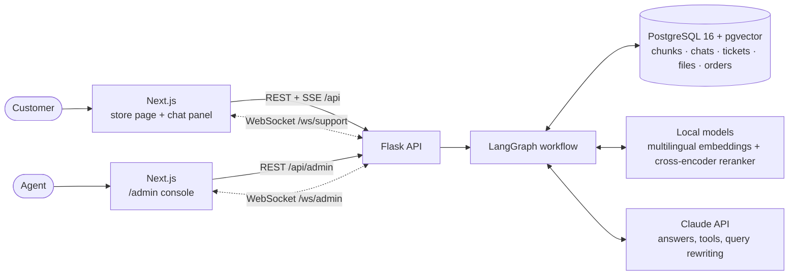

# ShopEase Help: a RAG customer-support assistant with live human handoff

A customer-support chat for a fictional Pakistani online store. The assistant answers from the store's
PDF handbook (English, Urdu and Roman Urdu), looks up live order status, and when a customer needs a
person it opens a support ticket that agents pick up in a real-time admin console.

**Live demo:** https://rag.store.fawadiqbal.dev · **Agent console:** `/admin` · **Plain-language guide:** [HOW_IT_WORKS.md](HOW_IT_WORKS.md)

## What it does

| For customers | For support agents |
|---|---|
| Answers from an 11-page PDF handbook, with the sources it used | `/admin` console: queue, active chats, closed tickets |
| Understands follow-ups and Urdu ("refund kitne din mein milta hai?") | Takes a ticket, sees the whole chat (bot answers included) |
| Looks up live order status (`SE10482931` … `SE10482936`) | Customer name, email, issue and attachments pinned on top |
| Streams the answer word by word, with a live retrieval trace | Replies in the customer's chat, quick replies, closes the ticket |
| "Talk to a person" → ticket form: name, email, issue, up to 3 files | Live stats: waiting, busy agents, average wait, answers vs. daily cap |
| Sees their number in the queue and the estimated wait, live | Everything updates instantly over WebSockets |
| Chats with the agent, typing indicators both ways, timestamps | "Customer is typing…" in the list and in the chat |
| Private chat history per browser, light and dark theme | Token-protected; files only downloadable by agents |

## Architecture



Every message runs through a LangGraph workflow:
`load memory → classify → rewrite → retrieve (↺ broaden once) → generate → save`, or
`classify → handoff` when the customer asks for a person. Details: [backend/docs/WORKFLOW.md](backend/docs/WORKFLOW.md).

## Tech stack

| Layer | Tools |
|---|---|
| Frontend | Next.js 14 (app router), React 18, Server-Sent Events, WebSockets |
| API | Flask 3, Pydantic, flask-sock, gunicorn |
| Workflow | LangGraph (state graph, conditional edges, custom stream events) |
| RAG | pdfplumber (+ tables, OCR), LangChain text splitter, sentence-transformers (`paraphrase-multilingual-MiniLM-L12-v2`, 384-dim), cross-encoder reranker |
| Search | PostgreSQL + pgvector (HNSW) + full-text search, fused with Reciprocal Rank Fusion |
| Models | Claude by default; any part swappable from `.env` (Ollama, OpenAI, vLLM…): [PROVIDERS.md](backend/docs/PROVIDERS.md) |
| Ops | Docker Compose, nginx (TLS, `/ws/` upgrade), daily `pg_dump` backups, one-command `deploy.sh` |

## Project layout

```
RAG/
├── backend/            Flask API, LangGraph workflow, RAG, support desk  → backend/README.md
├── frontend/           Next.js: store page, chat panel, /admin console
│   └── app/
│       ├── page.js                 landing page ("How it works" section included)
│       ├── components/SupportWidget.js   the chat panel (bot, ticket form, queue, agent chat)
│       ├── components/live.js      WebSocket helper (reconnects, typing notifier)
│       └── admin/                  the agent console
├── db/                 Postgres 16 + pgvector image
├── docker-compose.yml          local: database (+ optional Ollama)
├── docker-compose.prod.yml     server: db, api, web, backups (+ optional Ollama)
├── deploy.sh                   one-command deploy to the Oracle server
├── .env.prod.example           production settings template
└── HOW_IT_WORKS.md             the whole system explained simply
```

## Run it locally

You need Docker Desktop, Python 3.10+ and Node 20.

```bash
# 1. database
docker compose up -d

# 2. backend  (backend/.env needs ANTHROPIC_API_KEY, LLM_PROVIDER=anthropic, ADMIN_TOKEN)
cd backend
pip install -r requirements-dev.txt
pytest                       # 39 tests, no database or API key needed
python -m scripts.ingest     # read the PDF into the knowledge base: "[store] 63 chunks saved"
python -m app.main           # API + WebSockets on http://localhost:5000

# 3. frontend (second terminal)
cd frontend
npm install
npm run dev                  # http://localhost:3000  and  http://localhost:3000/admin
```

To try the human handoff: open the store and `/admin` side by side, click **Talk to a person** in the chat,
fill in the form, then take the ticket in `/admin` and reply.

## Deploy

```bash
cp .env.prod.example .env.prod      # fill in: RAG_DB_PASSWORD, ADMIN_TOKEN, ANTHROPIC_API_KEY, LLM_*
./deploy.sh
```

`deploy.sh` packs the project, uploads it and `.env.prod`, builds the containers, re-runs the ingest only when
the PDF or the ingest code changed, gets a TLS certificate the first time, and adds (or updates) the site's
nginx block with a backup and `nginx -t` before reloading.

## Configuration

| Setting (`backend/.env` / `.env.prod`) | Default | What it does |
|---|---|---|
| `LLM_PROVIDER`, `LLM_MODEL` | anthropic · claude-haiku-5-5 | The model that writes answers |
| `ANTHROPIC_API_KEY` | - | Claude key |
| `ADMIN_TOKEN` | - | Sign-in for `/admin` and `/api/admin/*` (16+ random characters) |
| `SUPPORT_AGENTS` | 2 | Agents on shift; each handles one chat at a time (queue estimate) |
| `AVG_HANDLE_MINUTES` | 5 | Wait estimate until real tickets give an average |
| `DATABASE_URL` | local Docker Postgres | Database connection |
| `EMBEDDING_*`, `RERANKER_PROVIDER`, `VECTOR_STORE` | local models, pgvector | See [PROVIDERS.md](backend/docs/PROVIDERS.md) |

Retrieval and memory knobs (`TOP_K`, `MIN_SCORE`, `MEMORY_TURNS`, rate limits, daily cap) live in
`backend/app/core/config.py`.

## Protection for a public demo

- Visitors are anonymous: the browser keeps a random id, and the API only returns that visitor's chats and tickets.
- Rate limits: 8 messages a minute per visitor, 30 per IP, 400 bot answers a day for the whole site.
- Uploads: 3 files, 5 MB each, images, PDF or text only; checked on the server; downloads need the admin token.
- Postgres and the local LLM are never exposed publicly; only nginx faces the internet.
